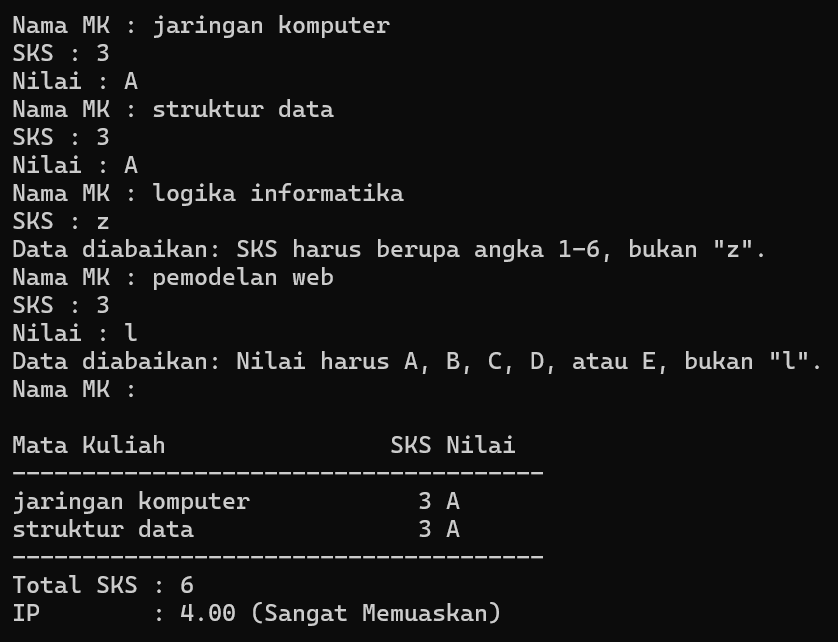

# Tugas Rutin 3 - Kalkulator IP Semester (Console)

**Nama:** Siti Haliza Zamili
**NIM:** 4241250019
**Kelas:** PSIK 24D

## Deskripsi
Program console Dart untuk menghitung IP (Indeks Prestasi) satu semester. Pengguna
memasukkan nama mata kuliah, SKS, dan nilai huruf secara berulang sampai nama
dikosongkan. Data yang salah diabaikan dengan pesan, tanpa membuat program berhenti.
Setelah selesai, program mencetak KHS sederhana berisi daftar mata kuliah (diurutkan
dari nilai tertinggi), total SKS, IP beserta predikat, dan mata kuliah yang perlu
diperbaiki.

## Cara Menjalankan
```
dart run bin/kalkulator_ip.dart
```

## Tangkapan Layar
Sesi berikut memuat input yang salah (SKS `3 sks` dan nilai `Z`) yang diabaikan,
lalu KHS tercetak di akhir.



## Penjelasan
Higher-order function saya pakai di tiga tempat. Fungsi `hitungIp` memakai `fold` untuk menjumlahkan total SKS dan total mutu (SKS dikali bobot), lalu keduanya dibagi untuk mendapat IP. Di fungsi `cetakKhs`, `where` menyaring mata kuliah berbobot di bawah 2 untuk daftar "perlu diperbaiki", dan `sort` dengan fungsi pembanding `(a, b) => bobot(b.nilai).compareTo(bobot(a.nilai))` mengurutkan KHS dari nilai tertinggi. Ketiganya menerima fungsi anonim sebagai argumen.

Error handling ada di `validasiSks` dan `validasiNilai`. Kedua fungsi itu melempar `FormatException` dengan `throw` bila SKS bukan angka 1-6 atau nilai bukan A-E. Exception tersebut tidak ditangani di dalam fungsinya, tetapi ditangkap di `main` dengan `try` dan `on FormatException catch`. Akibatnya data yang salah hanya diabaikan dengan pesan, dan program tetap berjalan sampai KHS tercetak, seperti terlihat pada tangkapan layar.

## Pernyataan Penggunaan AI
Saya menggunakan Claude (Anthropic) selama mengerjakan tugas ini.

**Dibantu AI:**
- Penjelasan materi Pertemuan 3 (modul dan slide).
- Kode `bin/kalkulator_ip.dart`.
- Langkah Git dan kerangka README.
- Draf bagian Penjelasan (saya baca, pahami, dan sesuaikan).

**Saya kerjakan sendiri:**
- Membuat proyek, menjalankan program, dan menguji input yang salah.
- Mengambil tangkapan layar, menjalankan `dart format` dan `dart analyze`.
- Membuat repository GitHub, commit, dan push.